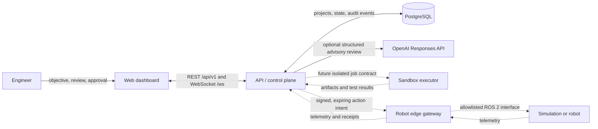
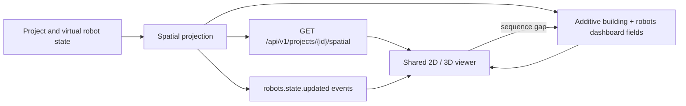

# NEXUS architecture

## Purpose and scope

NEXUS coordinates engineering work; it is not itself a safety-certified motion
controller. The core product records an objective, derives reviewable
requirements and tasks, runs bounded software or simulation experiments, and
streams results to a dashboard. A separate robotics edge is responsible for
translating approved intents into a deliberately small ROS 2 interface.

This split keeps the default developer stack lightweight and makes the most
dangerous boundary explicit.

Solid lines are implemented by the core MVP. Dashed lines are integration
boundaries that should be added behind explicit feature flags and safety gates.

## Core components

| Component | Responsibility | Must not do |
| --- | --- | --- |
| Dashboard | Project status, requirements, task graph, map/telemetry views, approval UI | Decide or enforce authorization |
| API/control plane | State transitions, policy checks, approvals, event streaming, audit writes | Directly publish arbitrary ROS commands |
| PostgreSQL | Durable project state, execution metadata, approvals, telemetry indexes, audit chain | Store large binary artifacts indefinitely |
| C++ navigation core | Deterministic occupancy-grid and navigation algorithms | Open networks or command actuators |
| OpenAI Engineering Reviewer (optional) | Produce a typed advisory review from bounded project evidence | Receive tools, authorize actions, change project state, or command hardware |
| Sandbox executor (next phase) | Build and test generated code under quotas | Mount the host Docker socket or inherit broad network access |
| Robot edge gateway (optional) | Authenticate the control plane, enforce command allowlists and limits, bridge ROS 2 | Execute free-form code received from the control plane |

Large maps, images, bags, build outputs, and simulation recordings should move
to content-addressed object storage. PostgreSQL stores their digest, media type,
size, provenance, and retention state.

## Implemented spatial data path

The current control plane projects a deterministic metric scene from project
state. This path is implemented, but it remains simulation-only:

The canonical frame is `building_enu`, measured in metres with `x` east, `y`
north, and `z` up. The delivered building is 24 m by 16 m with three floors at
0.0, 3.4, and 6.8 m. The projection contains rooms, wall segments, doors,
stairs/lift connectors, located hazards, bounded trails, and three virtual
robots. It is synthesized test data, not persisted SLAM/BIM geometry.

Both visual modes consume this one model. The route layer subtracts declared
door openings from wall solids, adds wall thickness to robot clearance, and
requires co-located connector transitions. The 2D view handles north-up plans,
safe pose interpolation, and all-floor small multiples; the Three.js view
handles top/isometric cameras, doorway-split wall meshes, orbit/pan/zoom, floor
filtering, follow mode, and selection. WebGL failure falls back to the 2D plan.
See [Digital twin and realtime](digital-twin.md).

## Optional model-assisted review

`POST /api/v1/projects/{id}/ai-review` is an implemented advisory boundary. The
API projects bounded project, requirement, task, telemetry, robot, and audit
evidence into an untrusted-data envelope and requests a typed Structured Output
from the configured OpenAI model. The provider receives no tools. A successful
review appends model, prompt-version, input digest, readiness, and finding-count
provenance to the hash-linked audit chain; provider failure is sanitized and
does not create a success record. The operation never starts work, grants an
approval, or changes the physical adapter state. See
[ADR 0004](decisions/0004-openai-engineering-review.md).

## Engineering workflow

Every project follows a state machine rather than a free-running agent loop:

1. Capture an objective and immutable source revision.
2. Produce versioned requirements with acceptance criteria and hazard notes.
3. Propose an architecture and task dependency graph.
4. Classify each task by capability and risk.
5. Require approval before granting a capability, not merely after generating a
   command.
6. Run code and simulation in an isolated executor with an input manifest,
   resource budget, deadline, and network policy.
7. Record test evidence, artifacts, logs, and the exact tool/model versions.
8. Promote only passing simulation output to a separately approved hardware
   intent.
9. Have the edge gateway re-check identity, expiry, robot state, limits, and
   emergency-stop status before action.
10. Append the decision, approval, result, and causal links to the audit log.

Failures may trigger a new proposed patch and experiment. They must not silently
rewrite the running control plane, safety policy, tests, or historical evidence.

## Interfaces

- HTTP resources are versioned under `/api/v1`.
- Live updates use `/ws/projects/{project_id}`. Messages carry schema version,
  process stream identifier, project identifier, event type, UTC timestamps,
  and a project-scoped sequence number.
- `/api/v1/health` is liveness. `/api/v1/ready` checks required dependencies
  without exposing credentials or internal topology.
- The initial snapshot is race-safe: the server subscribes first and queues any
  event committed while projection is being constructed.
- The bounded stream may drop old queued events for a slow subscriber; sequence
  gaps are detectable and cause REST reconciliation in the dashboard.
- Times are stored in UTC. Monotonic clocks are used locally for timeouts and
  dead-man timers.

Implemented REST resources are:

| Method | Path | Purpose |
| --- | --- | --- |
| `GET` | `/api/v1/health` | Process liveness |
| `GET` | `/api/v1/ready` | Database readiness |
| `GET`, `POST` | `/api/v1/projects` | List or create/decompose projects |
| `GET` | `/api/v1/projects/{id}` | Full project domain detail |
| `GET` | `/api/v1/projects/{id}/dashboard` | Dashboard projection, building, and fleet |
| `GET` | `/api/v1/projects/{id}/spatial` | Canonical read-only metric scene |
| `POST` | `/api/v1/projects/{id}/ai-review` | Optional structured, read-only OpenAI engineering review |
| `POST` | `/api/v1/projects/{id}/launch` | Start simulation or request physical approval |
| `POST` | `/api/v1/projects/{id}/mode` | Dashboard mode-request alias |
| `POST` | `/api/v1/approvals/{id}/decision` | Decide an approval |
| `POST` | `/api/v1/projects/{id}/approvals/{approval_id}/decision` | Project-scoped decision alias |
| `POST` | `/api/v1/projects/{id}/emergency-stop` | Latch project stop and cancel active simulation |
| `GET` | `/api/v1/projects/{id}/telemetry` | Recent telemetry |
| `GET` | `/api/v1/projects/{id}/audit` | Recent audit entries |
| `GET` | `/api/v1/projects/{id}/audit/verify` | Verify the full audit chain |

Idempotency keys, durable event delivery, `trace_id`, `correlation_id`, and
`causation_id` remain required hardening work before external or physical
commands are introduced; they are not claims about the current MVP.

Version robot-edge messages independently from the web API. A robot may remain
offline during a control-plane deployment and must reject an unsupported or
ambiguous command schema.

## Data model direction

The initial relational model should grow around these aggregates:

- `projects`, `objectives`, and versioned `requirements`;
- plans, tasks, dependencies, attempts, and artifacts;
- policy evaluations, approval requests, grants, denials, and revocations;
- experiments, immutable input manifests, test results, and environment digests;
- robot identities, capability leases, command intents, receipts, and telemetry
  metadata;
- append-only audit events with actor, action, target, reason, causal links,
  previous hash, event hash, signature, and signing-key identifier.

Store state changes and their audit event in one database transaction. Use an
outbox row in the same transaction for WebSocket updates and future job queues;
this avoids reporting an event that was never committed.

## Deployment profiles

`compose.yaml` is the **core development profile**: dashboard, API, and
PostgreSQL. It is loopback-bound and is not a production deployment definition.

The **simulation profile** adds a sandbox executor plus a Gazebo host or runner.
GPU simulation is deliberately separate because its drivers, display stack, and
resource needs vary by machine.

The **robotics-edge profile** runs near the robot. It maintains an outbound
authenticated session to the control plane and joins the local ROS domain. Do
not stretch DDS across an untrusted network or expose `rosbridge` to the public
Internet.

## Architectural invariants

1. The UI can request an approval but cannot satisfy or bypass one.
2. No model receives an unrestricted host shell, Docker socket, secret store, or
   robot network.
3. Simulation and physical execution are different capabilities and approvals.
4. A human approval is scoped, attributable, expiring, and revocable.
5. Safety checks exist at both the control plane and robot edge.
6. Generated output never overwrites evidence from the experiment that produced
   it.
7. Audit records are append-only and externally check-pointed for meaningful
   tamper evidence.

Material architectural changes should be captured in `docs/decisions/` before
implementation.
